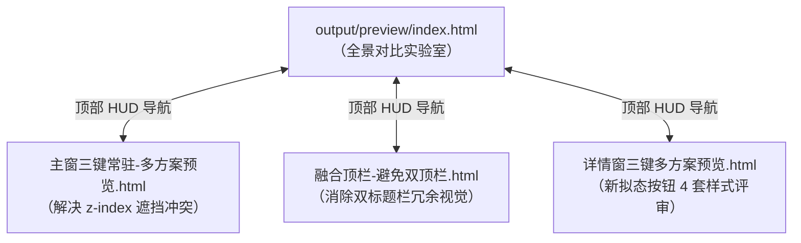

# 输出目录与产物规范

本文档为工程规范指南之一，正式定义 `output/` 目录的定位、结构层级、文件类型、HTML 预览功能价值与维护纪律。

> 对应本地实际目录：`output/`（由于包含大量自动化测试截图和临时产物，已被 `.gitignore` 排除）。

---

## 一、定位与架构原则

`output/` 目录用于承载**本地构建、自动化回归测试、视觉快照与轻量交互原型实验室**所产生的各类文件。

为保持工程整洁并杜绝磁盘膨胀与代码库污染，执行以下核心纪律：

1. **按域分类隔离**：所有脚本产物必须落入对应的业务子目录（如 `playwright/<套件名>/`、`image-*/`、`sidebar-*/`），严禁在根目录任意散落文件。
2. **严禁存放脚本源码**：`output/` 是纯粹的产物落地点。一切自动化测试脚本、验收用例必须存放在 `scripts/`，严禁在 `output` 及其子目录中编写或放置 `.mjs`、`.py` 脚本。
3. **严禁冗余构建副本**：严禁将 Vite / Tauri 等生产打包产物（`dist/`）复制或生成在 `output` 的子目录中。
4. **单文件自洽预览原则**：`output/preview/` 的交互原型必须保持单文件自洽（零构建、零依赖、本地双击即用），供设计与团队极速评审。

---

## 二、规范化目录拓扑

| 子目录 | 所属模块 / 功能域 | 生成来源 / 关联脚本 | 典型产物内容 | 生命周期建议 |
| :--- | :--- | :--- | :--- | :--- |
| **`preview/`** | 交互设计与动效实验室 | 手工维护 / 设计原型实验 | `index.html`、`主窗三键常驻-多方案预览.html`、`融合顶栏-避免双顶栏.html`、`详情窗三键多方案预览.html` | **长期保留**（设计评审与微动效调参资产） |
| **`release-<ver>/`** | 发版全量归档 | `scripts/build_release_packages.py`、`verify_frozen_release.py` | `build.log`、`frontend-tests.log`、`package-check.json`、`frozen/`（冻结 Sidecar 冒烟回读）、离线引擎源码压缩包 | **长期保留**（版本发布审计依据） |
| **`playwright/`** | 端到端自动化视觉回归 | `scripts/verify-*.mjs`、`scripts/goal-mindmap*.mjs` | 各套件子目录（`appearance-neu-select/`、`global-neu-sweep/`、`goal-mindmap/` 等）下的浅深色断言截图 | **可重新生成**（每次跑回归更新） |
| **`image-interactions/`** | 图像面板交互走查 | `scripts/verify-image-interactions.mjs` | 浅深色 800/1440 响应式截图、焦点复用与按键状态快照 | 可重新生成 |
| **`image-panel-motion/`** | 图像抽屉动效采样 | `scripts/verify-image-panel-motion.mjs` | 抽屉收展中间帧逐帧采样 JSON、宽窄屏截图 | 可重新生成 |
| **`image-resize/`** | 图片缩放功能与引擎 | `scripts/verify-image-resize.mjs`、`scripts/resize_validation_fixtures.py` | 尺寸测试结果 ZIP、回读 JSON、多模式缩放快照、`输入/` 测试样本 | 可重新生成 |
| **`image-settings-density/`** | 图像设置项密度与锁 | `scripts/verify-image-settings-density.mjs` | 设置项按任务显隐截图、比例锁键盘操作截图 | 可重新生成 |
| **`image-validation/`** | 多格式转换与压缩 | `scripts/verify-image-processing.mjs`、`scripts/image_validation_fixtures.py` | PNG/JPEG/WebP 互转产物 ZIP、验收结果 JSON、`输入/` 样本 | 可重新生成 |
| **`sidebar-collapse/`** | 侧栏密度与收起 | `scripts/verify-sidebar-collapse.mjs` | 14px/12px 间距截图、48px 按钮留白断言、逐帧文字退场采样 | 可重新生成 |
| **`sidebar-hover/`** | 悬停推开布局 | `scripts/verify-sidebar-hover.mjs` | 84px/280px 推开布局截图、坐标采样报告 JSON | 可重新生成 |
| **`sidebar-micro-motion/`** | 按钮悬停与按下微动效 | `scripts/verify-sidebar-micro-motion.mjs` | 1.06x 悬停放大、0.94x 按下回弹采样 JSON、浅深色截图 | 可重新生成 |
| **`sidebar-more-menu/`** | 侧边栏更多溢出菜单 | `scripts/verify-sidebar-more-menu.mjs` | 悬停菜单命中、浅深色与窄屏视口截图 | 可重新生成 |
| **`window-header/`** | 窗口顶栏与三键适配 | `scripts/verify-window-header.mjs` | `--baseline` 调整前快照及调整后对比截图、坐标 JSON | 可重新生成 |
| **`png-validation/`** | PNG 引擎与隔离服务 | `scripts/verify-png-compression.mjs`、`serve_png_validation.py` | 8898 独立端口服务压测、ZIP 结果、`profile/` 临时数据库沙箱 | 可重新生成 |
| **`website/`** | 官网静态验收 | `scripts/verify-website.mjs` | 静态链接检查、生产资源白名单校验、`静态验收.json` | 可重新生成 |

---

## 三、HTML 预览的功能与目的

### 1. 核心定位与目的

HTML 预览位于 `output/preview/`，是项目专属的**高保真、零依赖、独立可交互的原型实验室**。

其设计初衷主要为了解决以下研发痛点：
1. **脱离重型运行时进行秒级交互调参**：在桌面端应用（Tauri + Rust + SQLite）中，每次修改微动效或 CSS 变量都需要启动桌面壳，开销大且无法实时动态调节物理参数。通过 HTML 预览，开发者与设计师可直接在浏览器中利用 HUD 控制台拖拽滑块，在 60fps 环境下微调贝塞尔曲线、阻尼时间与尺寸，确定后再固化进工程源码。
2. **桌面窗口层级与无边框架构预演**：在无边框（frameless）桌面窗口中，全屏详情模态层与原生系统顶栏（最小化/最大化/关闭）存在 `z-index` 覆盖与点击穿透冲突。通过轻量 HTML 页面可先行直观验证不同架构方案（如避让开孔、克隆代理、单顶栏融合）的实际表现。
3. **新拟态设计（Neumorphism）A/B 决策前置**：在进入业务逻辑开发前，将多种不同视觉方案并置对比，确保其阴影与高光严格符合项目的 `--pc-neu-*` 设计令牌。

### 2. 页面清单与能力细分



- **`index.html`（侧栏微动效与主流案例全景实验室）**：
  - **动态参数控制台（HUD Console）**：集成展开宽度、动画时长（150~800ms）、缓动曲线（Bezier / Spring 弹性衰减 / Smooth / Linear）、进入/移出延迟、探照灯光斑坐标的实时滑块控制器。
  - **6 大标杆交互流派并置**：Linear 磁吸药丸、Neumorphic 探照灯跟随、Spring 弹性缓冲、Floating Dock 悬浮抽屉、Icon-to-Text Morphing、Accordion 手风琴展开。
  - **辅助工具**：深浅色主题一键切换、固定展开/悬停模式切换、互联导航。
- **`主窗三键常驻-多方案预览.html`（详情窗打开时主窗三键常驻）**：
  - **核心问题**：详情浮层 `z-index: 8800` 盖住主窗顶栏 `z-index: 2600`，导致软件最小化/最大化/关闭不可点。
  - **方案展示**：S1 顶栏常驻+弹窗避让（推荐）、S2 顶层三键克隆代理、S3 全局融合单条顶栏，附带反面案例对比。
- **`融合顶栏-避免双顶栏.html`（融合顶栏 · 避免双顶栏重复）**：
  - **核心理念**：全局仅保留一套窗口语义控件（− □ ×），详情窗降级为应用内芯片面板，避免出现“两层标题栏”的繁杂视觉与误触风险。
- **`详情窗三键多方案预览.html`（详情窗三键按钮 · 多方案预览）**：
  - **视觉方案对比**：展示方案 A（柔和圆角卡片新拟态）、方案 B（极简无边界悬浮）、方案 C（紧凑胶囊条）、方案 D（沉浸式集成）。
  - **令牌对齐**：完全基于项目 `--pc-neu-*` 调色板令牌构建。

---

## 四、文件清理与日常维护规范

### 1. 清理准则（禁止项）

- ❌ **禁止在 `output` 及其子目录下放置任何 `.mjs`、`.js`、`.py` 脚本**。如需编写测试用例，统一存入 `scripts/`。
- ❌ **禁止在 `output` 下保留 `build/` 生产构建包**。构建产物统一由 `dist/` 或 `releases/` 管理。
- ❌ **禁止散落无套件归属的调试临时截图**。必须通过自动化脚本输出至专属子目录。
- ❌ **定期清理历史过程运行日志**（如已归档任务的 `backend*.log`）。

### 2. 快速清理指南

如需重置输出目录或释放磁盘空间，可运行根目录提供的清理命令：

```powershell
# 清理自动化截图与过程日志，保留 HTML 原型与发版包
python -c "
import os, shutil
keep = {'preview', 'release-2.5.32'}
for item in os.listdir('output'):
    if item not in keep:
        p = os.path.join('output', item)
        if os.path.isdir(p):
            shutil.rmtree(p)
"
```
